# Project-6 · Hybrid Identity & Endpoint Management

**A full-stack enterprise simulation: on-premises Active Directory synchronized to Microsoft Entra ID, with Intune-managed endpoints, Conditional Access enforcement, Microsoft Defender for Endpoint onboarding, and a PowerShell automation toolkit — all built and validated in a home lab.**


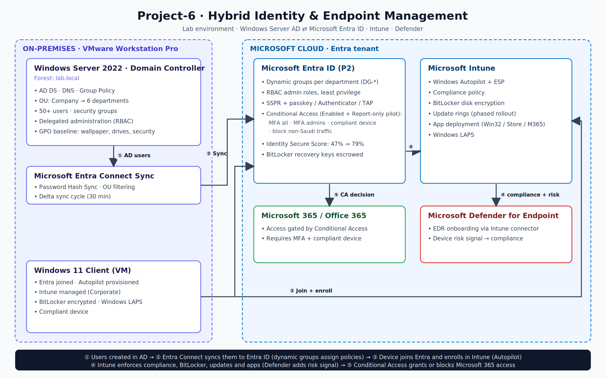

---

## Overview

| Area | What was built |
|---|---|
| **Directory** | `lab.local` forest — OU structure across 6 departments, 50+ users, security groups, GPO baseline |
| **Hybrid identity** | Entra Connect Sync with OU filtering and Password Hash Sync |
| **Cloud identity** | Dynamic groups, least-privilege RBAC, SSPR, MFA, Temporary Access Pass; SMS disabled |
| **Access control** | 4 Conditional Access policies: MFA enforcement, geo-restriction, compliant-device requirement |
| **Endpoint management** | 10 Configuration Profiles, compliance policy, Autopilot, BitLocker, LAPS, Update Rings, 7 apps |
| **Threat protection** | Microsoft Defender for Endpoint onboarded via Intune policy |
| **Automation** | 4 PowerShell scripts (Graph API): compliance report, inventory export, CA query, LAPS rotation |
| **Proven result** | Identity Secure Score improved **47% → 79%** · Noncompliant devices blocked in real time |

> **Scope:** built on VMware Workstation Pro to reflect the controls and architecture of real enterprise deployments.

---

## Environment

| Component | Details |
|---|---|
| Virtualization | VMware Workstation Pro |
| Domain controller | Windows Server 2022 — AD DS, DNS, Group Policy |
| Hybrid sync | Microsoft Entra Connect Sync |
| Cloud | Microsoft Entra ID P2, Microsoft Intune — Microsoft 365 E5 trial |
| Threat protection | Microsoft Defender for Endpoint (MDE) |
| Clients | Windows 11 VMs — Entra-joined, Intune-managed, Autopilot-provisioned |

---

## 1. Active Directory & Group Policy

A structured OU tree mirrors a real organization: six departments, 50+ user accounts with consistent naming, and security groups scoped per OU. A GPO baseline enforces a corporate desktop wallpaper and common security settings across all domain machines.

<table>
<tr>
<td width="50%">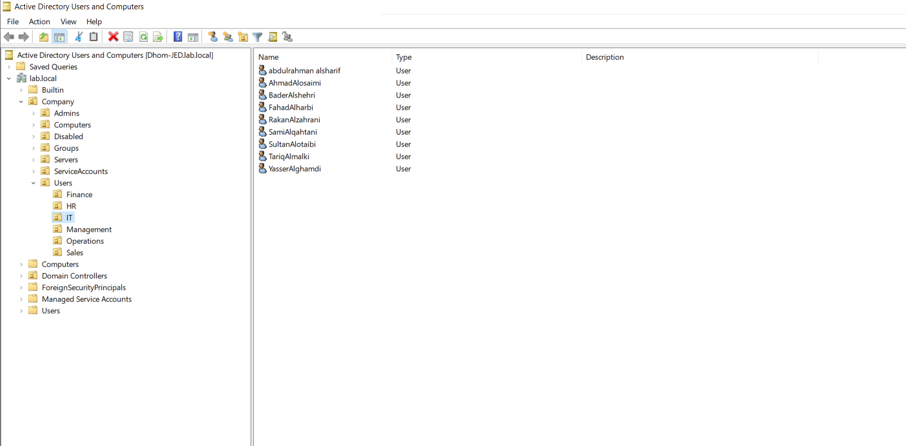<br><sub><b>OU structure</b> — Company root with 6 department sub-OUs</sub></td>
<td width="50%">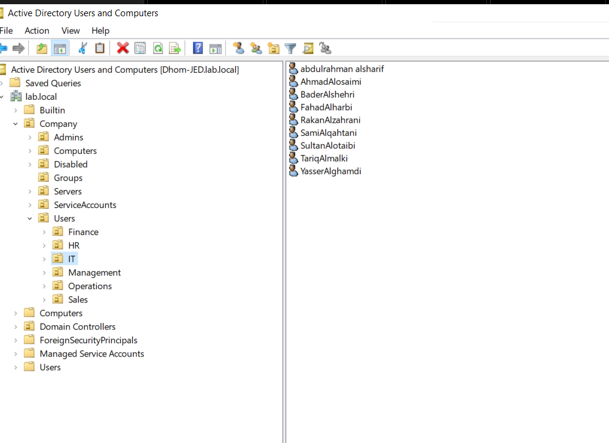<br><sub><b>Users</b> — 50+ accounts distributed across departments</sub></td>
</tr>
</table>

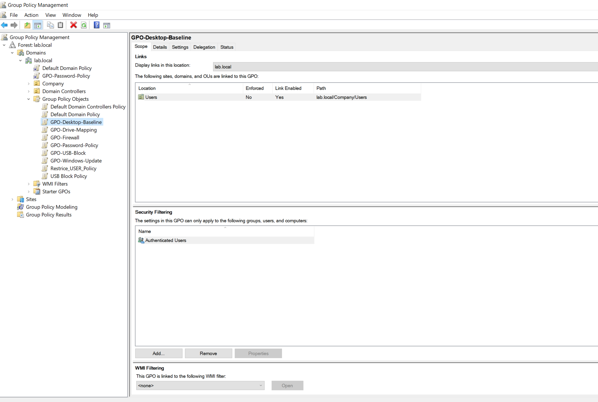
<br><sub><b>Group Policy</b> — baseline GPOs linked to the relevant OUs</sub>

---

## 2. Hybrid Identity — Entra Connect

- **OU filtering:** only the `Company` OU syncs to Entra ID; service accounts and admin objects stay on-premises.
- **Password Hash Sync** with Seamless SSO — users authenticate once for both on-prem and cloud resources.
- Delta sync verified end-to-end; synced accounts show source as **Windows Server AD** in Entra.


<br><sub><b>Sync status and OU filtering</b> — only the intended OU reaches the cloud</sub>

---

## 3. Identity Security & Conditional Access

### Dynamic Groups & SSPR

- **Dynamic groups** per department auto-assign membership from the synced `department` attribute — no manual maintenance.
- **SSPR** enabled with passkey, Microsoft Authenticator, and Temporary Access Pass; SMS removed.
- **Authentication strengths** enforce phishing-resistant MFA for privileged roles.

<table>
<tr>
<td width="50%">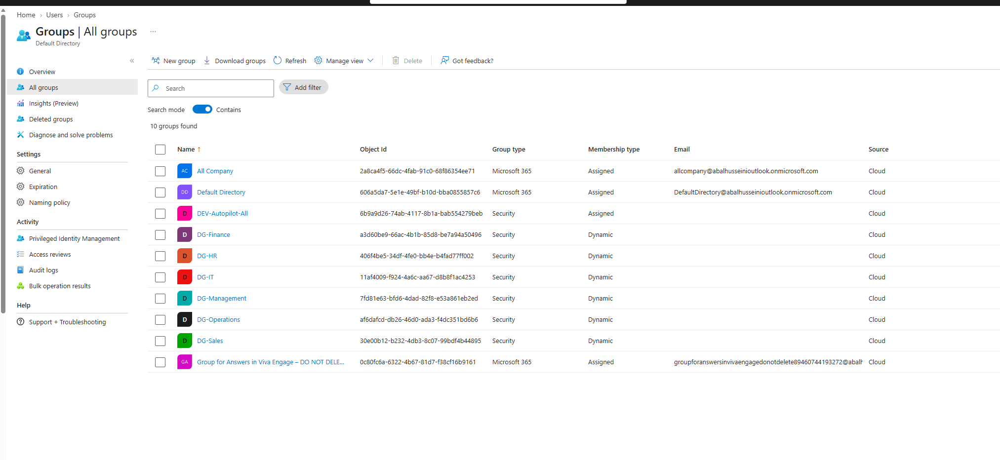<br><sub><b>Dynamic groups</b> — auto-membership by department attribute</sub></td>
<td width="50%">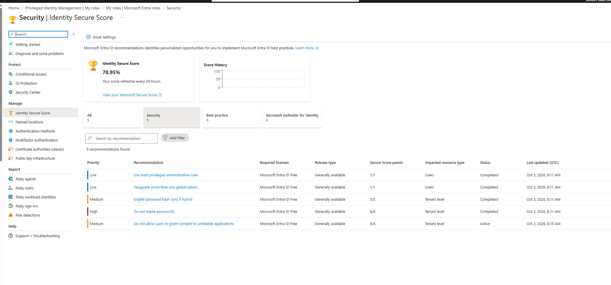<br><sub><b>Identity Secure Score: 47% → 79%</b></sub></td>
</tr>
</table>

### Conditional Access — 4 Enforced Policies

All policies were validated in **Report-only mode with What If analysis** before enforcement. The compliant-device policy went live immediately; the remaining three are in Report-only pending a broader rollout simulation.

| # | Policy | Target | Grant control | State |
|---|---|---|---|---|
| 1 | Require MFA — all users | All users | Require MFA | Report-only |
| 2 | Require MFA — admin roles | Directory roles | Require MFA + phishing-resistant | Report-only |
| 3 | Block non-Saudi traffic | All users | Block | Report-only |
| 4 | Require compliant device — Office 365 | All users | Require Intune-compliant device | **Enforced** |

<table>
<tr>
<td width="50%">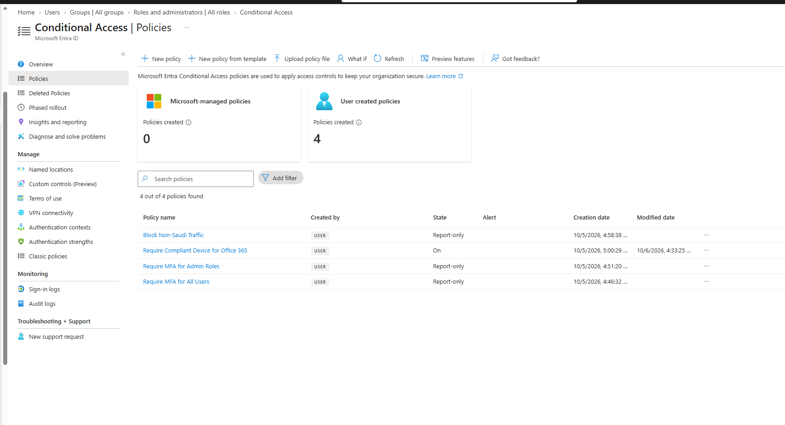<br><sub><b>CA policies overview</b></sub></td>
<td width="50%">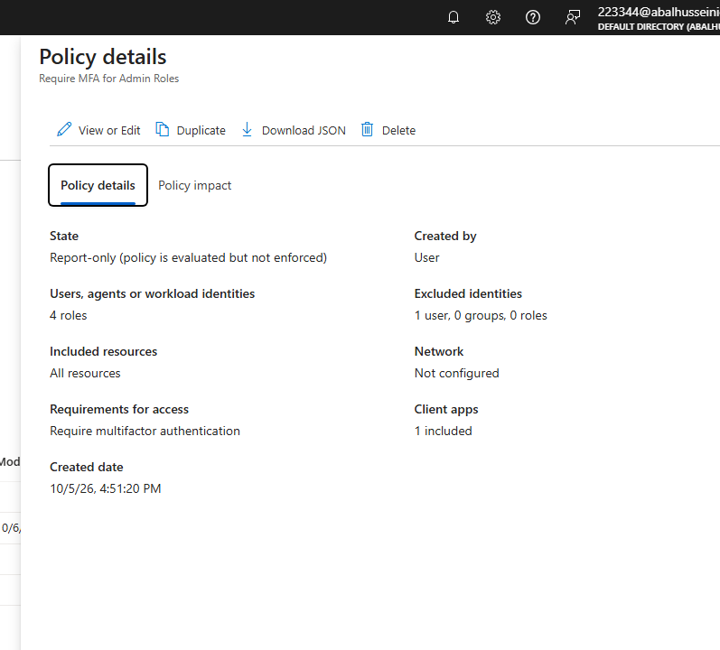<br><sub><b>Admin MFA policy</b> with break-glass exclusion</sub></td>
</tr>
</table>

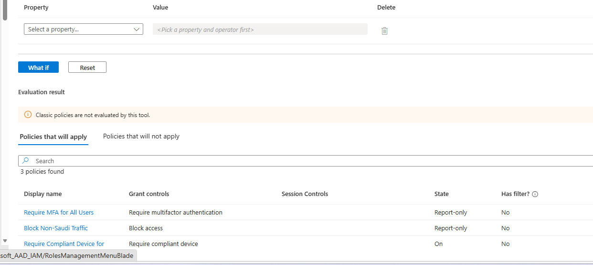
<br><sub><b>What If</b> — validating policy impact before enforcement</sub>

### Zero-Trust Enforcement — Proven

The screenshot below is captured live: a non-compliant device is **blocked in real time** from accessing Office 365 resources. The user has valid credentials but the device fails the compliance check — access is denied until the device meets the policy requirements. This is Zero-Trust working as designed.

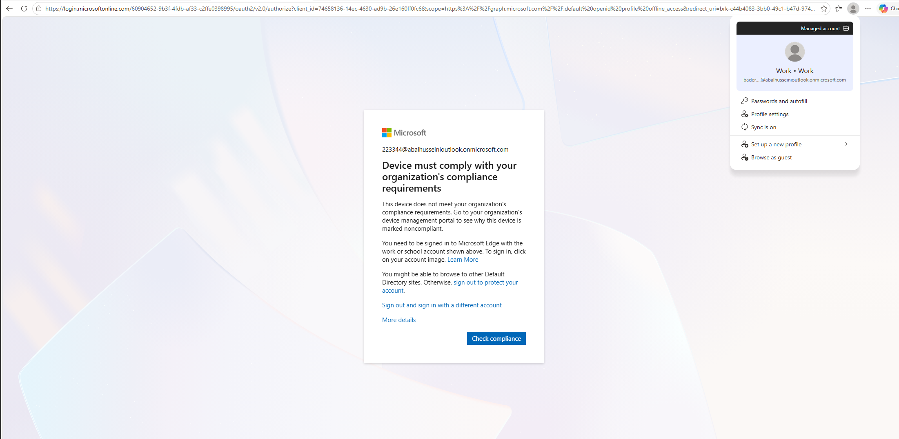
<br><sub><b>CA enforcement in action</b> — noncompliant device blocked from Office 365. The Intune-compliant device policy denies access until compliance is restored.</sub>

---

## 4. Endpoint Management — Microsoft Intune

All 11 enrolled devices are **Corporate-owned, Intune-managed**. 10 are compliant; 1 is intentionally left noncompliant to validate CA enforcement behavior (see section above and LAPS rotation below).

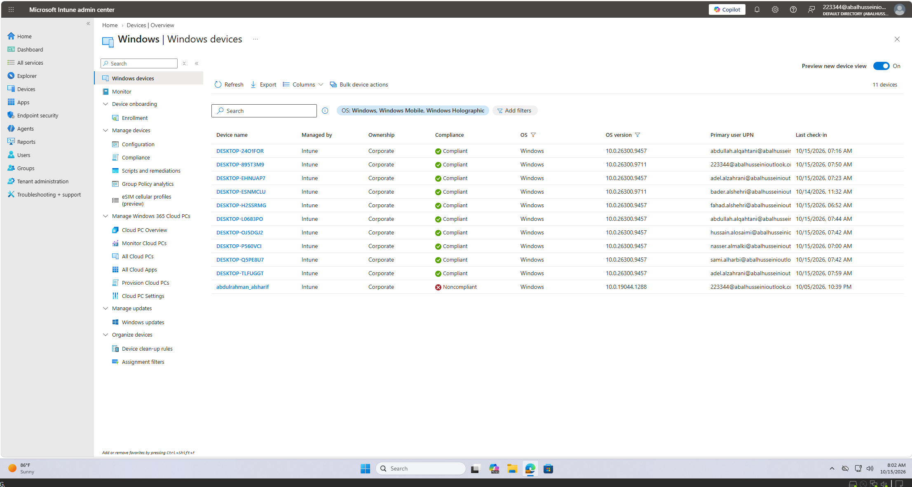
<br><sub><b>Devices overview</b> — 11 enrolled Windows devices across Windows 10 and Windows 11</sub>

### 4.1 Configuration Profiles — 10 Policies

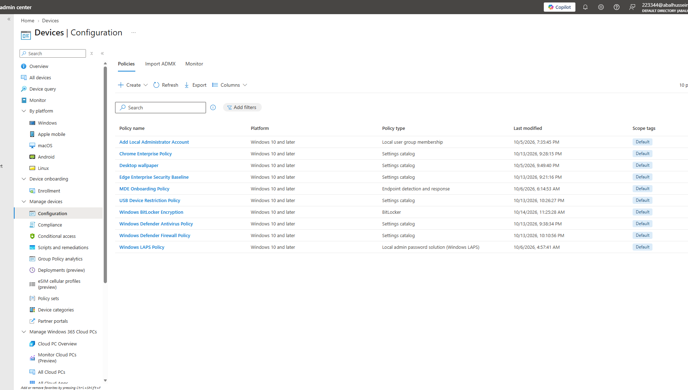

| Profile | Type | Purpose |
|---|---|---|
| Add Local Administrator Account | Local user group membership | Standardize local admin membership |
| Chrome Enterprise Policy | Settings catalog | Enforce browser security controls |
| Desktop wallpaper | Settings catalog | Corporate branding via Win32 app |
| Edge Enterprise Security Baseline | Settings catalog | Harden Microsoft Edge |
| **MDE Onboarding Policy** | **Endpoint detection and response** | **Onboard devices to Microsoft Defender for Endpoint** |
| USB Device Restriction Policy | Settings catalog | Block unauthorized removable storage |
| Windows BitLocker Encryption | BitLocker | Full-disk encryption with key escrow |
| Windows Defender Antivirus Policy | Settings catalog | Enforce real-time protection settings |
| Windows Defender Firewall Policy | Settings catalog | Enforce host-based firewall rules |
| Windows LAPS Policy | Local admin password solution | Unique rotating local admin passwords |

### 4.2 Autopilot & Enrollment Status Page

Devices receive their full configuration at first sign-in with no IT touch.

<table>
<tr>
<td width="50%">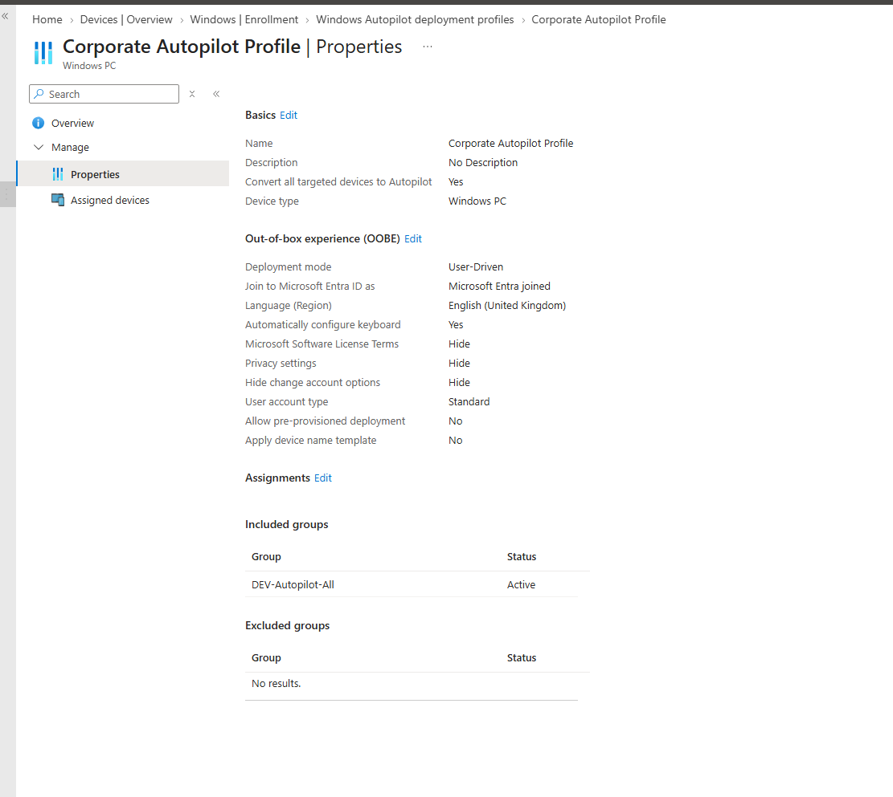<br><sub><b>Autopilot</b> — deployment profile configuration</sub></td>
<td width="50%">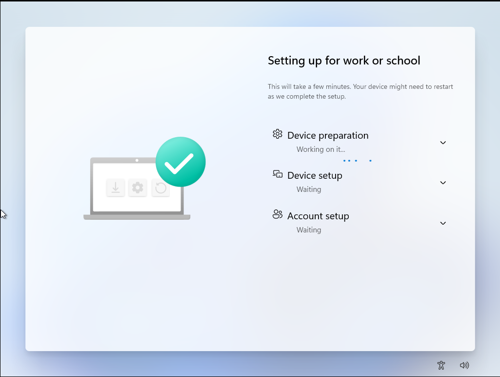<br><sub><b>Enrollment Status Page</b> during OOBE provisioning</sub></td>
</tr>
</table>

### 4.3 Compliance & BitLocker

<table>
<tr>
<td width="50%">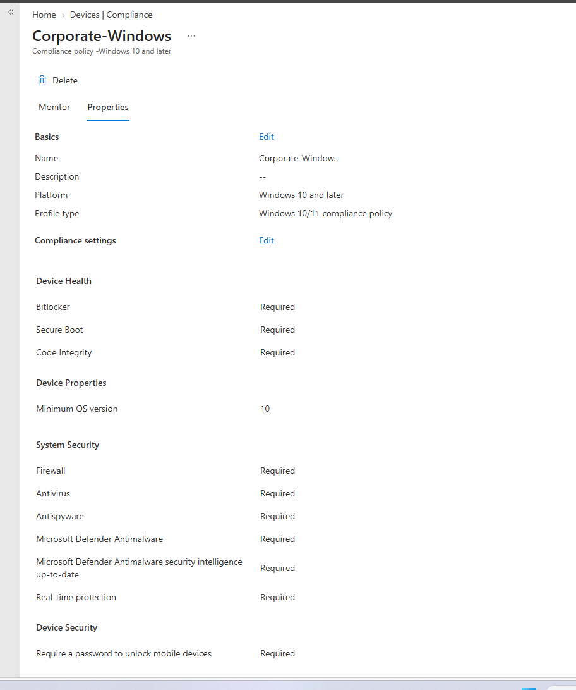<br><sub><b>Compliance policy</b></sub></td>
<td width="50%">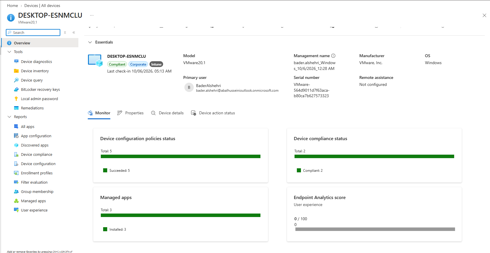<br><sub><b>Device status:</b> compliant</sub></td>
</tr>
<tr>
<td width="50%"><br><sub><b>BitLocker</b> — silent encryption enforced</sub></td>
<td width="50%">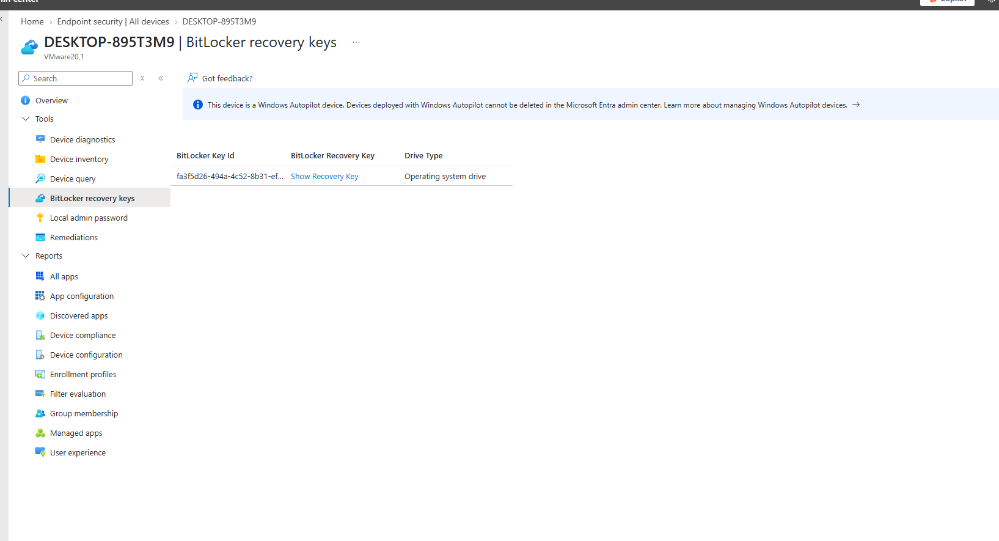<br><sub><b>Recovery key escrowed</b> — retrievable from Intune per device</sub></td>
</tr>
</table>

### 4.4 Update Rings & Application Deployment

Update Rings deliver Windows updates in a phased rollout. The screenshot shows a managed device receiving an enforced update — proof the ring policy is actively applied.

<table>
<tr>
<td width="50%">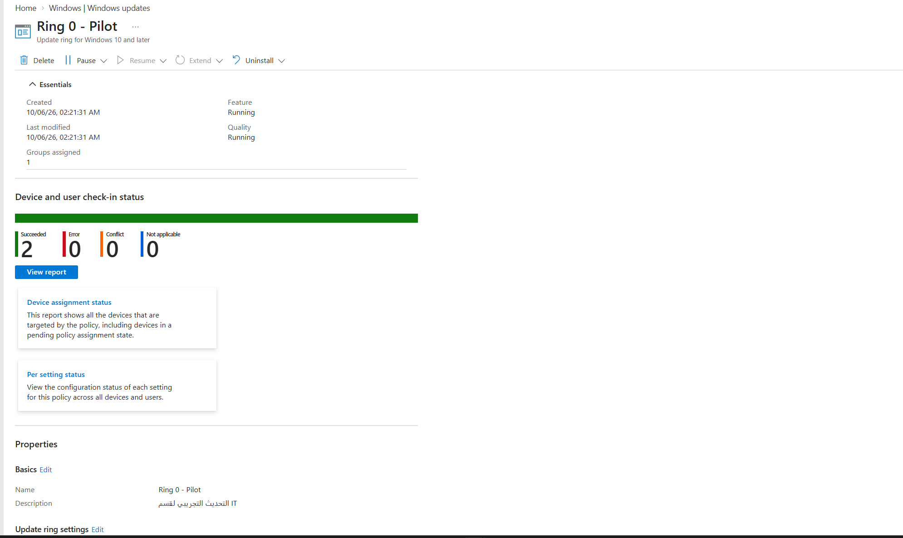<br><sub><b>Update rings</b> — phased rollout policy</sub></td>
<td width="50%">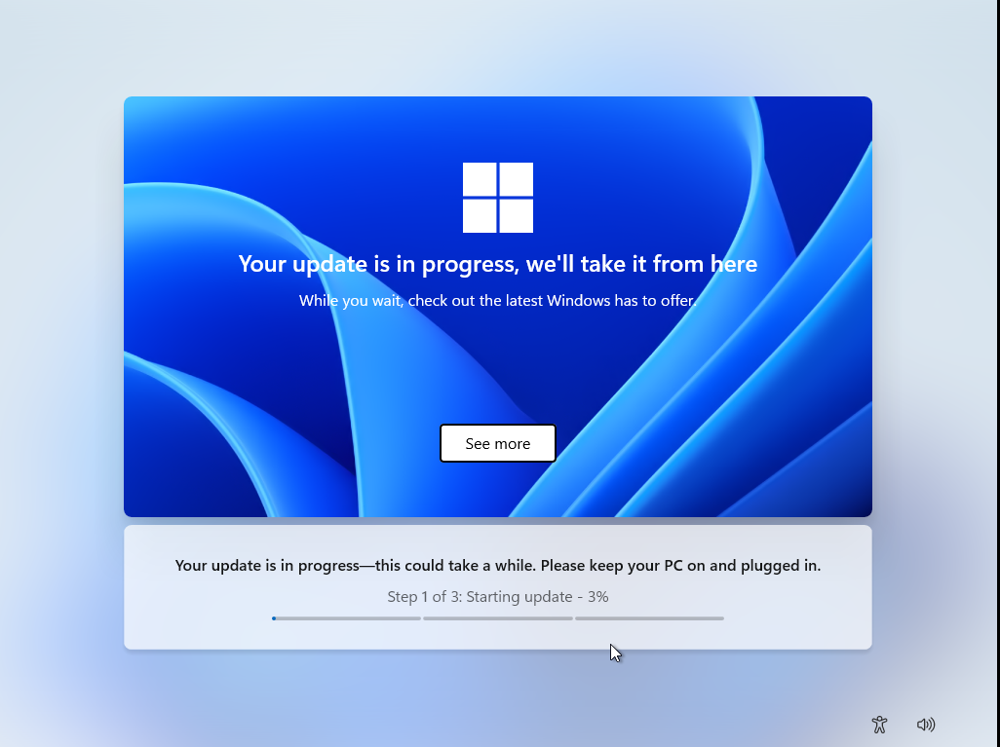<br><sub><b>Managed update in progress</b> — enforced by Intune Update Ring</sub></td>
</tr>
</table>

Seven applications deployed automatically to all enrolled devices via Intune, covering productivity, security tooling, and corporate branding:

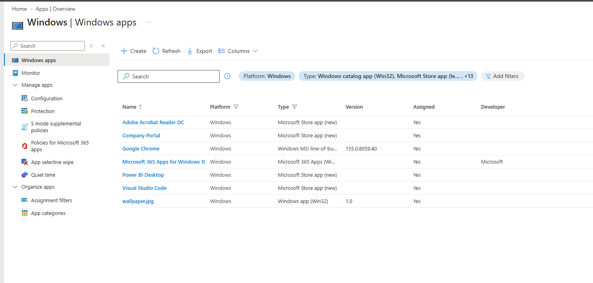

| App | Deployment type | Assigned |
|---|---|---|
| Microsoft 365 Apps | M365 Apps (Office suite) | ✅ Yes |
| Google Chrome | Windows MSI (v155.0.8059.40) | ✅ Yes |
| Adobe Acrobat Reader DC | Microsoft Store (new) | ✅ Yes |
| Company Portal | Microsoft Store (new) | ✅ Yes |
| Power BI Desktop | Microsoft Store (new) | ✅ Yes |
| Visual Studio Code | Microsoft Store (new) | ✅ Yes |
| Corporate wallpaper | Win32 app (v1.0) | ✅ Yes |

### 4.5 Windows LAPS

Each device has a unique, rotated local administrator password stored in Entra ID. Administrators retrieve it on demand — no shared passwords across devices.

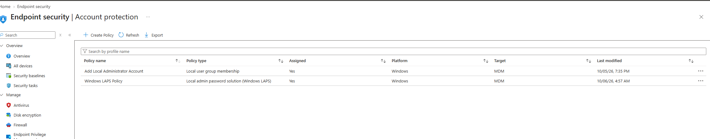
<br><sub><b>Windows LAPS</b> — unique local admin password per device, stored in Entra ID</sub>

### 4.6 Microsoft Defender for Endpoint

MDE is onboarded to all enrolled devices via the **MDE Onboarding Policy** (Endpoint detection and response profile in Intune). Device risk signals from Defender can now feed into Conditional Access compliance evaluations — a non-compliant or high-risk device is automatically blocked from resources.

---

## 5. PowerShell Automation Toolkit

All four scripts connect to Microsoft Graph using the `Microsoft.Graph` PowerShell SDK and operate against the Intune and Entra ID APIs. They are available in the `/scripts` folder of this repository.

### Script 1 — `Get-UncompiantDevices.ps1`

Queries all enrolled Windows devices and returns name, UPN, OS, and compliance state. Identifies any non-compliant device for immediate remediation.

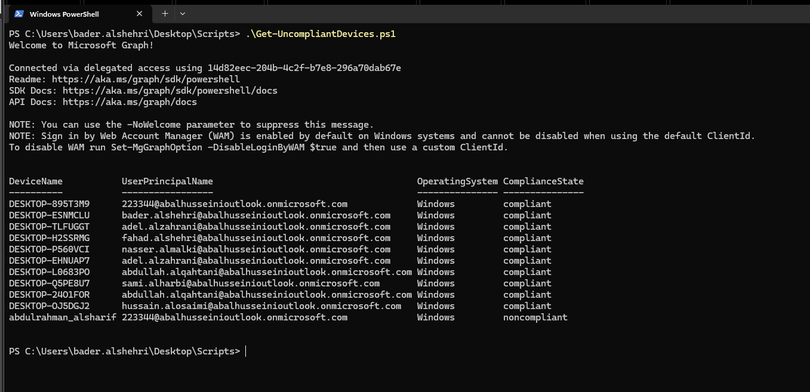
<br><sub><b>Get-UncompiantDevices.ps1</b> — 10 compliant, 1 noncompliant identified</sub>

### Script 2 — `Export-IntuneInventory.ps1`

Exports a full device inventory (name, model, serial number, OS version, compliance state) to a CSV file for reporting and auditing.

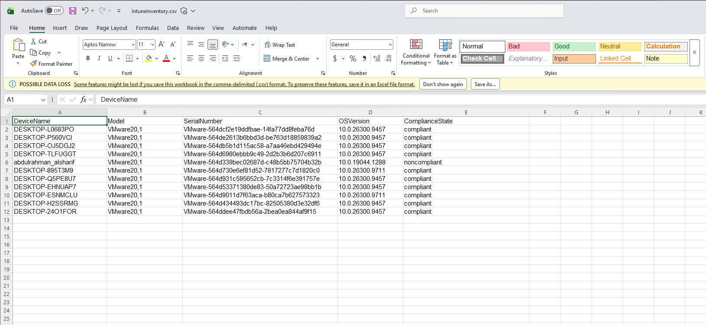
<br><sub><b>IntuneInventory.csv</b> — exported via Graph API, opened in Excel</sub>

### Script 3 — `Set-ConditionalAccessPolicy.ps1`

Retrieves all Conditional Access policies and displays their current state. Useful for auditing policy status across the tenant without opening the portal.

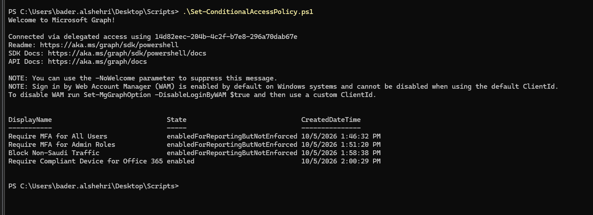
<br><sub><b>Set-ConditionalAccessPolicy.ps1</b> — all 4 policies listed with enforcement state</sub>

### Script 4 — `Invoke-LAPSPasswordRotate.ps1`

Triggers an immediate LAPS password rotation for all enrolled devices via the Graph API. Useful when a local admin account is suspected compromised.

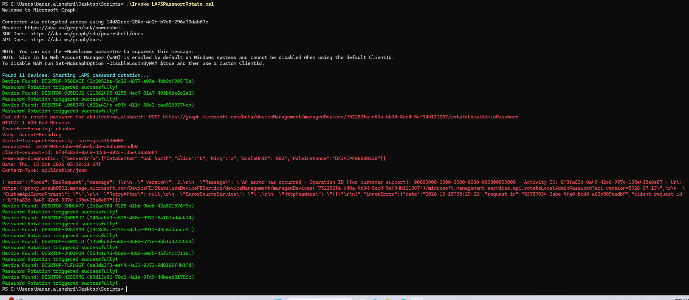
<br><sub><b>Invoke-LAPSPasswordRotate.ps1</b> — bulk LAPS rotation across all devices; failure on noncompliant device is expected (see Challenges)</sub>

---

## 6. Security Design Decisions

| Decision | Reason |
|---|---|
| Report-only first, then enforce | Validates policy impact with What If before any user is locked out |
| Break-glass account excluded from all CA policies | Guarantees tenant recovery if a policy misconfiguration locks out admins |
| Least-privilege admin roles | Limits blast radius of a compromised admin account |
| OU filtering in Entra Connect | Only intended objects reach the cloud; service and admin accounts stay on-prem |
| BitLocker recovery keys escrowed in Entra ID | Encrypted devices remain recoverable without manual key management |
| Phased Update Rings | A bad update is contained before reaching the full device population |
| Devices without a compliance policy treated as non-compliant | Prevents unmanaged gaps — new devices are blocked by default until a policy is assigned |
| USB Device Restriction Policy | Blocks data exfiltration via removable media |
| MDE Onboarding via Intune policy | Centralized threat protection without manual agent installation |
| LAPS per device | Eliminates lateral movement risk from shared local admin passwords |

---

## 7. Challenges & Solutions

### Entra Connect — application-based authentication failure

**Symptom:** the wizard stopped at "could not configure application-based authentication" without a clear UI error.

**Diagnosis:** reading the trace log (`C:\ProgramData\Microsoft\Azure AD Connect\Trace-*.log`) revealed `AADSTS700016` — the app registration was created in the tenant but the service principal was not available when the wizard tried to obtain a token.

**Resolution:** removed the incomplete app registrations from Entra ID and restarted the Entra Connect installation. On the second run, the application and service principal were created correctly in sequence. Delta sync now shows **Success**.

**Lesson:** the wizard's on-screen errors are surface-level. The trace log contains the actual error codes and API responses.

---

### Newly enrolled device shows "Not compliant"

**Cause:** the compliance policy was assigned to a dynamic group. The device enrolled before the dynamic group membership was evaluated, leaving it unassigned to the policy.

**Fix:** adjusted the compliance policy assignment to target **All Devices** with an assignment filter. Devices with no policy are treated as non-compliant by default — this is intentional and correct behavior.

---

### LAPS rotation fails on the noncompliant device — expected behavior

When `Invoke-LAPSPasswordRotate.ps1` was run against all 11 devices, 10 rotations succeeded. The noncompliant device (`abdulrahman_alsharif`) returned **HTTP 400 Bad Request**.

**Root cause:** LAPS password rotation via the Graph API (`rotateLocalAdminPassword`) requires the device to be in a managed and reachable state. A noncompliant device may have reduced management channel availability depending on the applied CA policy.

**Takeaway:** LAPS rotation failures surface compliance gaps that might otherwise go unnoticed. This is documented as a design boundary, not a bug — remediating the device's compliance restores full LAPS management.

---

## 8. Skills Demonstrated

`Active Directory` · `Group Policy (GPO)` · `Microsoft Entra ID P2` · `Entra Connect Sync` · `Hybrid Identity` · `SSPR` · `Dynamic Groups` · `Conditional Access` · `Zero-Trust Architecture` · `Microsoft Intune MDM` · `Windows Autopilot` · `Enrollment Status Page` · `Configuration Profiles` · `Compliance Policies` · `BitLocker` · `Windows LAPS` · `Update Rings` · `App Deployment (Win32, MSI, Store)` · `Microsoft Defender for Endpoint` · `RBAC` · `PowerShell` · `Microsoft Graph API` · `Technical Documentation` · `Troubleshooting`

---

## 9. Next Steps

| Priority | Item | Notes |
|---|---|---|
| High | MDE device risk signal in Conditional Access compliance | MDE is onboarded — next: tie device risk level to CA grant control |
| High | Privileged Identity Management (PIM) | Just-in-time admin role activation; reduces standing privilege |
| Medium | Identity Protection — risk-based Conditional Access | Block or step-up auth on risky sign-ins automatically |
| Medium | Password writeback | Allow cloud-initiated password resets to sync back to on-prem AD |
| Low | Intune Remediations (proactive scripts) | Detect and auto-fix configuration drift on endpoints |

---

## Repository Structure

```
.
├── README.md
├── images/
│   ├── hybrid-architecture-diagram.png
│   ├── ou-structure-diagram.png
│   ├── ad-users-list.png
│   ├── gpo-management.png
│   ├── sync-status & ou-filtering .png
│   ├── dynamic-groups.png
│   ├── secure-score.png
│   ├── ca-policies-list.png
│   ├── ca-mfa-admins-details.png
│   ├── ca-what-if-proof.png
│   ├── ca-enforcement-blocked.png        ← NEW
│   ├── autopilot-device-profile.png
│   ├── esp-oobe.png
│   ├── compliance-policy.png
│   ├── device-compliant.png
│   ├── bitlocker.png
│   ├── bitlocker-recovery-key.png        ← NEW
│   ├── update-rings.png
│   ├── update-in-progress.png            ← NEW
│   ├── apps-deployed-full.png            ← NEW
│   ├── configuration-profiles.png        ← NEW
│   ├── devices-overview.png              ← NEW
│   ├── laps.png
│   ├── ps-get-devices.png                ← NEW
│   ├── ps-inventory-csv.png              ← NEW
│   ├── ps-ca-policies.png                ← NEW
│   └── ps-laps-rotation.png             ← NEW
└── scripts/
    ├── Get-UncompiantDevices.ps1
    ├── Export-IntuneInventory.ps1
    ├── Set-ConditionalAccessPolicy.ps1
    └── Invoke-LAPSPasswordRotate.ps1
```

---


## Author

**Abdulrahman AlSharif** · IT Support & Cloud Endpoint Management
[LinkedIn](https://linkedin.com/in/abdulrahmansa) · [GitHub](https://github.com/abd-alhusseini)

<sub>All screenshots are from a lab environment. Identifiers and secrets have been redacted.</sub>
